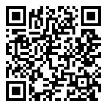

# Dashboard Widgets Toolkit

- Author: [Richard McQuiston](mailto:richard.mcquiston@gmail.com)
- Website: https://richardmcquiston.com/
- Demo: https://dashboard-widgets-toolkit-demo.vercel.app/

## Table of Contents

| [Overview](#overview) | [Getting Started](#getting-started) | [Widget Kinds](#widget-kinds) | [More Information](#more-information) | [Buy Me a Coffee](#buy-me-a-coffee) | [License](#license) | [Copyright](#copyright) |

## Overview

`@richardmcquiston01/dashboard-widgets-toolkit` helps you build dashboards out of widgets. A widget is one card on the dashboard, such as a number, a meter, a table, or a chart. The toolkit works with any framework and includes React components that draw the widgets.

It gives you:

- Typed widget definitions and data payloads. A payload is the data one widget shows.
- A layout that each viewer can change. They can reorder (by buttons, or by dragging with the `draggable` prop), hide, and minimize widgets.
- React renderers, including accessible charts drawn as Scalable Vector Graphics (SVG), each with a "View as table" twin.
- Controls for viewers, all saved in the layout: an edit mode, pages of widgets, and an Options dialog for each widget's title, width, view and options. A viewer can also duplicate a widget into a clone with its own settings.
- Locks that keep chosen widgets in place, a detail view with search, sort and paging, and CSS-variable theming with a `WidgetTheme` wrapper, contrast and color-vision checks, and presets.
- Storage helpers (an adapter contract and a `useStoredLayout` hook) so you can keep layouts in localStorage, a database or a server.

You bring your own data. The package never fetches or stores anything. You register a provider for each widget, such as a database query, a web request, or a computed value. You also save each viewer's layout wherever you like. Payloads are plain JavaScript Object Notation (JSON), so a server can resolve widgets and a browser can check and draw them.

The package has three parts:

| Import path                                                  | What it is                                                                                                                                                                  |
| ------------------------------------------------------------ | --------------------------------------------------------------------------------------------------------------------------------------------------------------------------- |
| `@richardmcquiston01/dashboard-widgets-toolkit` (or `/core`) | Runtime-neutral core (Node, Bun, browsers): definitions, payload types, validators, `resolveWidgets`, layout, formatting. No DOM, no network, no storage.                    |
| `@richardmcquiston01/dashboard-widgets-toolkit/react`        | React (18+) renderers: `WidgetCard`, one renderer per kind, `WidgetGrid`, a layout-aware `Dashboard`, and accessible inline-SVG charts with a "View as table" twin.          |
| `@richardmcquiston01/dashboard-widgets-toolkit/styles.css`   | Optional stylesheet. Components are unstyled by default and carry stable `dwt-*` class names.                                                                               |

[Back to Top](#table-of-contents)

## Getting Started

The [Getting Started guide](./GETTING_STARTED.md) has the full walkthrough and more than a dozen examples. The short version is below.

### Prerequisites

- Node.js 18 or newer, or Bun 1.3 or newer (or any modern browser bundler)
- React 18 or newer, only if you use `/react`
- TypeScript is optional. Type declarations are included.

### Installation

```bash
bun add @richardmcquiston01/dashboard-widgets-toolkit
# or
npm install @richardmcquiston01/dashboard-widgets-toolkit
```

### Usage

Define your widgets, write a provider for each one, then resolve them. A failing provider never breaks the dashboard. That widget comes back with an error message and the others still load.

```ts
import {
  defineWidget,
  resolveWidgets,
  type WidgetContext,
  type WidgetProviders,
} from '@richardmcquiston01/dashboard-widgets-toolkit';

interface ShopContext extends WidgetContext {
  shopId: string;
}

const widgets = [
  defineWidget({ key: 'revenue', title: 'Revenue', kind: 'KPI', sortOrder: 10 }),
];

const providers: WidgetProviders<ShopContext> = {
  revenue: async ({ shopId }) => {
    const { current, previous } = await loadRevenue(shopId); // your code
    return {
      kind: 'KPI',
      value: current,
      previous,
      format: 'currency',
      label: 'Revenue',
    };
  },
};

const resolved = await resolveWidgets(widgets, providers, {
  shopId: 'shop-1',
  roles: ['owner'], // widgets limited to other roles are skipped
});
```

To show the result in React, pass the resolved widgets to the `Dashboard` component:

```tsx
import { Dashboard } from '@richardmcquiston01/dashboard-widgets-toolkit/react';
import '@richardmcquiston01/dashboard-widgets-toolkit/styles.css'; // optional

<Dashboard widgets={resolved} />;
```

Without `onLayoutChange`, the dashboard is read-only. The guide shows how to let viewers move, hide, and minimize widgets and how to save their layout.

### Examples

The [Getting Started guide](./GETTING_STARTED.md#examples) covers these, and more:

- [Layout functions on their own](./GETTING_STARTED.md#layout-functions-on-their-own)
- [Styling with Tailwind (or any classes)](./GETTING_STARTED.md#styling-with-tailwind-or-any-classes)
- [Detail view](./GETTING_STARTED.md#detail-view)
- [Declared options](./GETTING_STARTED.md#declared-options) and [the Options dialog](./GETTING_STARTED.md#viewer-settings-the-options-dialog)
- [Alternate views](./GETTING_STARTED.md#alternate-views), including [views your provider supplies](./GETTING_STARTED.md#views-your-provider-supplies), and [clones](./GETTING_STARTED.md#clones)
- [Locked widgets](./GETTING_STARTED.md#locked-widgets) and [edit mode](./GETTING_STARTED.md#edit-mode-customize-and-done)
- [Pages of widgets](./GETTING_STARTED.md#pages-of-widgets-core)
- [Storing the layout](./GETTING_STARTED.md#storing-the-layout)
- [Theming](./GETTING_STARTED.md#theming)

[Back to Top](#table-of-contents)

## Widget Kinds

| Kind         | Payload fields                                                                                                   | Typical use                                |
| ------------ | ---------------------------------------------------------------------------------------------------------------- | ------------------------------------------ |
| `TEXT`       | `value: string`, `label`                                                                                         | A count or status as text                  |
| `KPI`        | `value: number`, `previous?: number \| null`, `format`, `currency?`, `label`, `hint?`, `higherIsBetter?`         | Stat tile with a change vs previous period |
| `GAUGE`      | `value`, `max`, `label`                                                                                          | A meter (unread of total, quota used)      |
| `TABLE`      | `columns: {label, numeric?, type?, formatter?}[]`, `rows: {text, href?, value?}[][]`, `footer?`                  | Small data tables                          |
| `BAR_LIST`   | `items: {label, value, display?}[]`, `total?`                                                                    | Ratings breakdown, purchases by country    |
| `ALERT_LIST` | `items: {title, href?, thumbnailUrl?, valueLabel, detail?}[]`, `total`, `emptyText`                              | Low stock, stale listings, expiring soon   |
| `GRAPH`      | `series: {name, points: {label, value}[]}[]`, `chartType: 'bar' \| 'line'`, `valueFormat`, `currency?`, `xLabel?` | Revenue by month, views per day            |

`KPI` stands for Key Performance Indicator.

`format` and `valueFormat` are `'number' | 'currency' | 'percent'`. Money is in major units (12.5 is $12.50). Percents are fractions (0.25 is 25%). Any widget may return an empty state instead: `{ empty: true, text: 'No orders synced yet.' }`.

A `TABLE` cell's optional `value` (a string or number) is what the card's table controls and the detail view sort and search on. Use it when `text` is made for reading, such as a timestamp behind "3 days ago", a rating behind stars, or an amount behind "$1,234.00". The `tableControls` setting on the widget definition turns the controls on.

[Back to Top](#table-of-contents)

## More Information

- [Getting Started guide](./GETTING_STARTED.md): installation, usage, and every example
- [Roadmap](./ROADMAP.md): what has shipped and what is planned
- [Changelog](./CHANGELOG.md): what changed in each release
- [Contributing notes](./CLAUDE.md): scripts, conventions, and how to release
- Design notes for each feature, with what is built and what is still planned:
  - [Detail view](./docs/design/detail-view.md)
  - [Widget extensions](./docs/design/widget-extensions.md)
  - [Lock and edit mode](./docs/design/lock-and-edit-mode.md)
  - [Widget options, views, and clones](./docs/design/widget-options-views-clones.md)
  - [Widget pages](./docs/design/widget-pages.md)
  - [Storage adapters](./docs/design/storage-adapters.md)
  - [Theming](./docs/design/theming.md)

[Back to Top](#table-of-contents)

## Buy Me a Coffee

If this app, code, or repository has helped you or someone you know, please consider donating. I appreciate any help to offset the costs of development and/or AI Credits.

[**Donate via Stripe**](https://donate.stripe.com/00w5kD3Gj1Xo9v7gVOcs800), or scan:

[](https://donate.stripe.com/00w5kD3Gj1Xo9v7gVOcs800)

[Back to Top](#table-of-contents)

## License

Apache 2

[Back to Top](#table-of-contents)

## Copyright

(c)2026 Richard McQuiston. All rights reserved.

[Back to Top](#table-of-contents)
